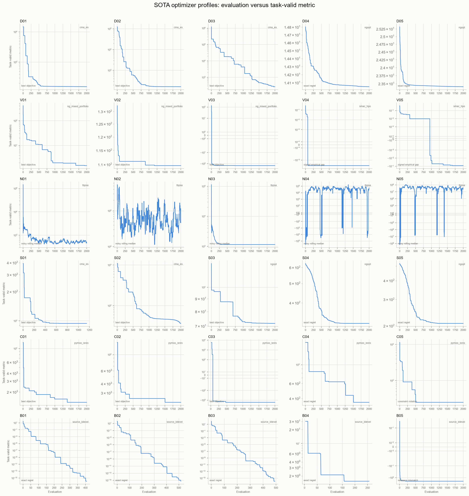

# Optimization-Agent Benchmark

This repository implements the 30 function-visible tasks defined in
`optimization_agent_benchmark_suite.md`. It intentionally contains no LLM,
Claude, OpenAI, prompt, or blind-agent implementation. Optimizers receive a
callable objective (and constraints where appropriate), matching the ordinary
`src/` methods in the reference project.

## What is implemented

- One registry for all IDs `D01` through `B05`.
- A shared result type with the constraint convention `g(x) <= 0`.
- Evaluation-budget accounting and JSONL query logs.
- COCO BBOB, MixInt, Noisy, and Constrained adapters.
- Direct CEC-2017 F5/F6/F8 implementations using packaged official
  shift/rotation data from `opfunu` (the package is used only as a data source).
- YAHPO adapters with fixed `task_id`, `trainsize=1.0`, and `repl=1`.
- Nevergrad noisy artificial-function adapters.
- pymoo G04 and G07 adapters.
- Direct SMD2, SMD3, and SMD6 equations with separate upper/lower calls.
- Direct BOLIB Calamai-Vicente 1994b and Allende-Still 2013 equations.
- Exactly one source-backed SOTA optimizer selection for each of the 30 tasks,
  plus the older baselines for controlled comparisons.
- Pinned problem-backend versions so benchmark definitions do not drift when
  a dependency publishes a new release.
- GitHub-style benchmark visualization: scientifically labelled optimization
  profiles, final-performance bars, and a cross-suite dashboard.

## Install

Use Python 3.11 for the complete suite. YAHPO's current dependency stack is not
reliably compatible with Python 3.13. With Anaconda on Windows:

```powershell
conda create -n optbench python=3.11 -y
conda activate optbench
python -m pip install --upgrade pip
python -m pip install -e ".[full]"
python -m pip install -e ".[hpo]"
```

The second install selects modern SMAC/ConfigSpace for V04-V05. Pip may report
YAHPO 1.0.2's old ConfigSpace metadata pin; the adapter supplies the one removed
private compatibility hook that YAHPO calls.

COCO is a compiled extension. If pip cannot find a wheel on Windows, install
Microsoft C++ Build Tools, then repeat the install command. The non-COCO core
and tests do not require a compiler.

YAHPO also needs its v1.0.2 model/data bundle:

```powershell
git clone --depth 1 --branch v1.0.2 https://github.com/slds-lmu/yahpo_data.git external/yahpo_data
python -c "from yahpo_gym import local_config; local_config.init_config(); local_config.set_data_path(r'external/yahpo_data')"
```

## Inspect and run

```powershell
# List all 30 registered tasks without importing optional backends.
optbench list

# Show the single SOTA optimizer assigned to every task.
optbench sota-methods

# Show exactly what an optimizer is allowed to see.
optbench inspect D01

# Small smoke campaign.
optbench run --problem C04 --optimizer random_search --seed 0 --budget 20

# True bilevel smoke campaign. The outer and inner budgets are separate.
optbench run --problem B01 --optimizer nested_random --seed 0 --budget 4 --inner-budget 20

# Safely preview the SOTA assignment across all 30 tasks; this does not execute.
optbench matrix --optimizers auto --seeds 0

# Run all 30 selected SOTA methods with the requested maximum budget and then
# generate task-valid optimization profiles.
optbench sota --budget 2000 --inner-budget 100

# Resume safely after an interruption; completed 2,000-evaluation runs are skipped.
optbench sota --budget 2000 --inner-budget 100 --resume

# Run one numbered task directly; task001 maps to D01 and task030 maps to B05.
python -m optbench.tasks.task001 --budget 2000

# Visualize every completed campaign. Figures are written to results/figures.
optbench plot --input results/raw --output results/figures

# Visualize selected tasks only.
optbench plot --input results/raw --problems D01 C04 B01

# Test the implementation.
python -m pytest
```

Results are written under `results/raw/<run_id>/` as `trace.jsonl` and
`summary.json`. Every objective query is retained.

The `sota` workflow writes production results under `results/sota/raw/`, the
dashboard to `results/sota/figures/iteration_profiles.png`, and a completion
record to `results/sota/sota_manifest.json`.

## Completed 2,000-evaluation campaign



The checked campaign completed all 30 tasks with zero execution failures.
Twenty-five tasks used the full 2,000-evaluation allowance; B01-B04 and S01
stopped earlier under their optimizer termination criteria. C05 (pymoo G7)
did not find a feasible point at seed 0 within the allowance, so its panel plots
best constraint violation instead of treating an infeasible objective as a
successful result.

## One SOTA method per task

| Task IDs | Selected optimizer |
|---|---|
| D01-D03 | CMA-ES |
| D04-D05 | Nevergrad NGOpt |
| V01-V03 | Nevergrad PortfolioDiscreteOnePlusOne |
| V04-V05 | SMAC HyperparameterOptimizationFacade |
| N01-N05 | Nevergrad TBPSA |
| S01-S02 | CMA-ES |
| S03-S05 | Nevergrad NGOpt |
| C01-C05 | pymoo ISRES |
| B01-B05 | Source-structured bilevel optimizer |

The mapping is centralized in `src/optbench/sota.py`. The numbered launchers
`src/optbench/tasks/task001.py` through `task030.py` are intentionally thin:
they call that mapping instead of duplicating optimizer logic thirty times.
For V04-V05, SMAC retains its HPO random-forest/EI pipeline with 1,024
acquisition challengers and a model refit every 32 suggestions so optimizer
overhead does not dominate the inexpensive YAHPO surrogate calls.

## Visualizing benchmark results

The plotting command follows the comparison style used by the reference
repository while respecting the additional scientific rules required by this
suite:

- `convergence.png` shows the median best-valid objective and interquartile
  range across seeds. Constrained and bilevel tasks receive a second panel for
  total constraint/lower-level-optimality violation.
- `final_performance.png` compares final valid objectives. An optimizer with no
  valid result is marked explicitly instead of displaying an invalid objective
  as if it were successful.
- `suite_rank_heatmap.png` compares within-task ranks. Raw objective values are
  never compared across unrelated task families.
- `optimization_profile.png` selects the scientifically valid metric for each
  task: exact regret, signed empirical gap, best objective, a rolling noisy
  objective, or constraint violation. `iteration_profiles.png` places all 30
  profiles in one dashboard. The older regret filenames remain compatibility
  copies.
- `plot_manifest.json` records exactly which runs and semantics produced the
  figures.

For reliable uncertainty bands, run the same optimizer with several shared
seeds before plotting, for example:

```powershell
optbench matrix --problems C04 --optimizers random_search sobol de `
  --seeds 0 1 2 3 4 --execute
optbench plot --problems C04
```

## Important benchmark choices

The source specification leaves three details undefined. They are frozen here
so different agents are compared on the same problem.

1. **YAHPO target:** minimize `logloss`. Training fraction is fixed to `1.0`
   and replicate ID to `1`.
2. **BOLIB search boxes:** B04 uses `[-5, 5]` for all variables; B05 uses
   `[0, 2]`. These are benchmark search domains, not new mathematical
   constraints. Published BOLIB constraints remain unchanged.
3. **Nevergrad box:** N04/N05 use `[-5, 5]^20`, because the Markdown specifies
   no finite domain but the selected function-aware methods require one.

The Markdown combines CEC-2017 IDs with function names that do not match the
official CEC-2017 ID-to-function map. This implementation follows the *named
equation* in the Markdown (Rastrigin, Expanded Schaffer F6, or Non-Continuous
Rastrigin) and uses the shift/rotation data for its stated ID. It does not call
`opfunu`'s evaluators. This policy is explicit because silently choosing either
the ID or the name would define a different benchmark.

## Adding a task yourself

1. Subclass `BenchmarkProblem` or `BilevelProblem` in `src/optbench/problems/`.
2. Return `EvaluationResult`; convert every inequality to `g <= 0`.
3. Add one lazy factory in `src/optbench/registry.py`.
4. Add a known-point and budget test under `tests/`.
5. Run `python -m pytest`, then a small `optbench run` smoke campaign.

## Definition sources

- Reference layout and function-aware optimizers: https://github.com/Mahyar-rajabi94/Cheapest_opt_lunch
- COCO suites and Python interface: https://coco-platform.org/getting-started/index.html
- CEC source data: https://github.com/P-N-Suganthan/CEC2017-BoundContrained
- YAHPO Gym and surrogate data: https://github.com/slds-lmu/yahpo_gym and https://github.com/slds-lmu/yahpo_data
- Nevergrad optimizer guidance: https://facebookresearch.github.io/nevergrad/optimization.html
- pymoo ISRES: https://pymoo.org/algorithms/soo/sres.html
- SMAC HPO facade: https://automl.github.io/SMAC3/latest/api/smac/facade/hyperparameter_optimization_facade/
- SMD definitions: https://faculty.iima.ac.in/asinha/bilevel/resources.html
- BOLIB definitions: https://www.bolib.org/problems/quadratic_bilevel/ and https://www.bolib.org/problems/quadratically_constrained_quadratic_bilevel/

